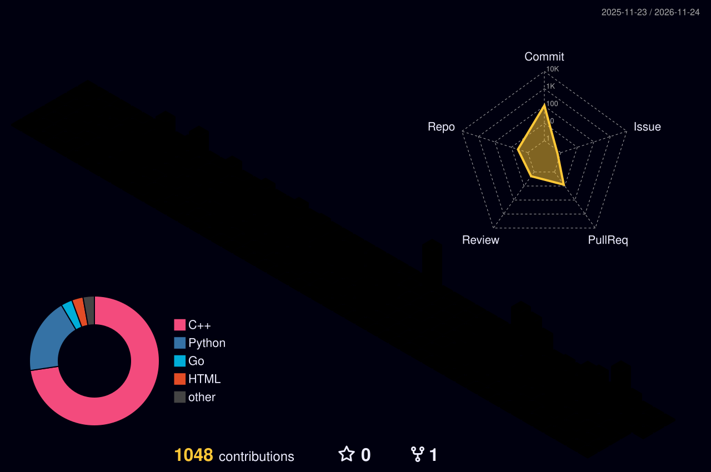

## Léo Lacordaire

Software engineering student at [Epitech](https://www.epitech.eu/), 3rd year, based in Strasbourg, France.

My contributions:

<picture>
  <source media="(prefers-color-scheme: dark)" srcset="profile-3d-contrib/profile-night-rainbow.svg" />
  <source media="(prefers-color-scheme: light)" srcset="profile-3d-contrib/profile-gitblock.svg" />
  
</picture>

I do a lot of backend and DevOps work, plus side projects when I have the time.

I also do freelance web development under the name Lacordaire Web Development, building websites for small businesses and independents. The website is coming soon. Until then, DM me on Instagram: [@lacordaire.web.development](https://instagram.com/lacordaire.web.development).
